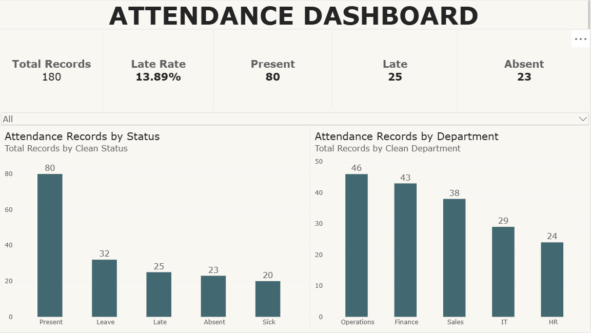
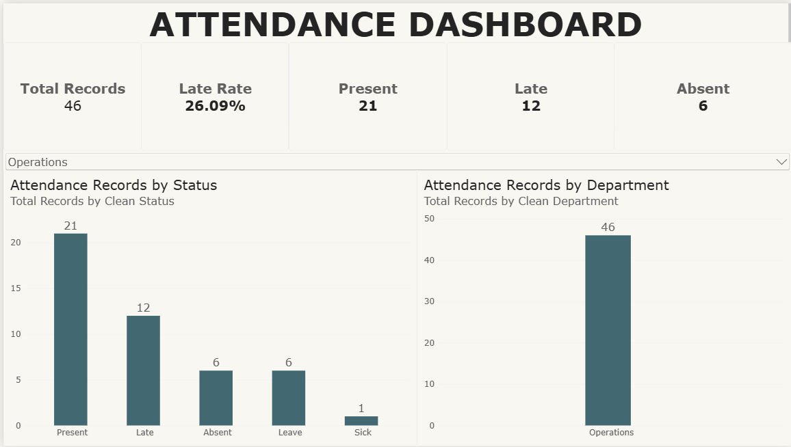

# Employee Attendance Dashboard

An employee attendance analysis project using **Microsoft Excel** and **Power BI**. This project covers data cleaning, attendance analysis, KPI tracking, and interactive dashboard visualization.

## Dashboard Preview

## Project Overview

The goal of this project is to analyze employee attendance records and present key attendance metrics in an interactive dashboard.

## Tools Used

- **Microsoft Excel** — Data cleaning, duplicate checking, data preparation, and preliminary analysis.
- **Microsoft Power BI** — Data modeling, DAX measures, KPI cards, charts, and interactive filtering.

## Key Metrics

- Total Attendance Records: 180
- Present Records: 80
- Late Records: 25
- Absent Records: 23
- Late Rate: 13.89%

*Note: The late rate represents the percentage of attendance records marked as "Late" out of all attendance records.*

## Dashboard Features

- KPI cards for total records, present, late, absent, and late rate.
- Attendance records by status.
- Attendance records by department.
- Department slicer for interactive filtering.

## Project Workflow

1. Prepare the raw attendance data in Excel.
2. Clean the data and check for duplicate records.
3. Prepare the cleaned dataset for analysis.
4. Import the dataset into Power BI.
5. Create DAX measures for attendance KPIs.
6. Build visualizations and an interactive dashboard.

## Key Takeaways

This project demonstrates foundational skills in data cleaning, data analysis, KPI development, data visualization, and interactive reporting.

## Notes

This is a practice portfolio project. Ensure that any shared dataset contains no confidential or personally identifiable employee information.
